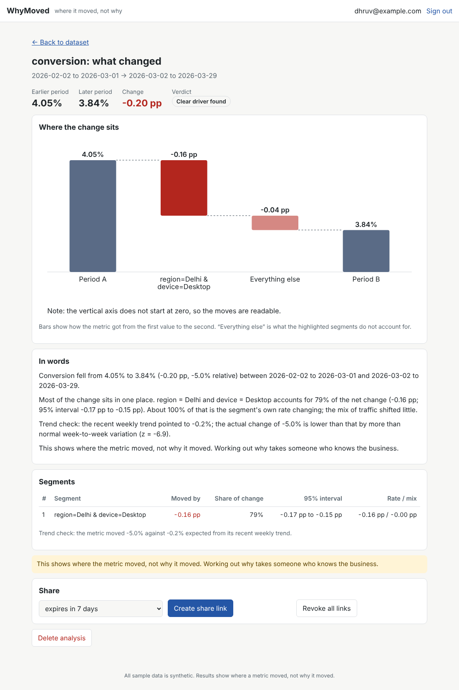

# WhyMoved

Upload a metric table, pick two periods, and get a ranked explanation of which
segments drove the change. It localises changes (where); it does not prove causes (why).

> **All data in this repository is SYNTHETIC.** It is generated by
> `src/whymoved/generator.py` with fixed seeds and planted, known causes so the
> analysis engine can be benchmarked against ground truth.



*Sample-data run on synthetic data: a conversion drop localised to one planted segment
(Delhi on Desktop). On phones it reflows: [docs/img/analysis_mobile.png](docs/img/analysis_mobile.png).*

## What it is, and how it differs from similar tools
Tools such as Power BI's "explain the increase/decrease" and Tableau's "Explain Data" suggest
factors behind a number inside a BI tool. WhyMoved is a small standalone project with a
different aim: separate segments' own rate changes from mix shifts, peel overlapping findings,
attach bootstrap intervals, say "no clear driver" when that is the honest answer, and publish a
benchmark against planted ground truth (docs/BENCHMARK.md). This comparison comes from my
general knowledge of those products; I did not test them side by side, and they do far more
than this project does (connectors, dashboards, scale). It localises changes; it never claims causes.

## Run it
`docker build -t whymoved . && docker run -p 8000:8000 -v whymoved-data:/data whymoved`, or the
two-line pip route in docs/DEPLOY.md, then `python scripts/smoke_test.py http://127.0.0.1:8000`.
Hosting caveats (free tiers lose SQLite data) are in docs/DEPLOY.md.

## Status
- [x] M0 Setup
- [x] M1 Synthetic generator: 9 scenario kinds, planted causes, finance and market columns
- [x] M2 Decomposition engine (additive and ratio metrics, mix vs rate)
- [x] M3 Trust layer: bootstrap significance, low-sample guard, overlap peeling, verdict
- [x] M4 Ingest: CSV/xlsx reader, column-role guessing, cleaning, validation report
- [x] M5 Derived metrics (formulas), trend check, budget vs actual, written summaries
- [x] M6 Price/volume/mix revenue bridge and profit bridge (adds a cost-per-unit effect)
- [x] M7 Market share bridge (market growth / exposure / share) and monthly trend analysis
- [x] M8 Statement ratios (18 ratios), balance checks, DuPont split of ROE, synthetic company
- [x] M9 Benchmark suite (docs/BENCHMARK.md), sensitivity sweep, placebo test, failure gallery; public-data check script (not yet run on real data)
- [x] M10 Service layer (accounts, workspaces, uploads, analyses, share links) + FastAPI adapter (adapter NOT yet run: see README)
- [x] M11 Browser app (plain JavaScript, no build step), tested in headless Chromium; see "Web app (M11)"
- [x] M12 Dockerfile, deploy notes (docs/DEPLOY.md), smoke test; the Docker image itself is NOT yet built or run
- [x] M13 Financial-statement import and the finance screens (see "Statements and the other analyses (M13)")
- [x] M14 Notes (the "why" written by people), watchlist, company comparison, metric scan, Markdown/CSV/PDF export (see "What M14 adds")

## Benchmark (synthetic data; full tables in docs/BENCHMARK.md)

Run `python scripts/run_benchmark.py` (about 10 minutes on 2 CPU cores). 100 new seeds per scenario:

- Planted drop of 50% in one segment, including noisy, budget and mix-only variants: first
  finding right in 100% of runs (96-100% interval). Two causes sharing an attribute: both
  found in the top 3 in 100%, but described exactly in only 77% (the rest as a broader segment).
- No change planted: 0 of 100 runs reported a driver; 0 of 40 random-week placebo splits did.
- Price/cost/share bridges located the planted segment in 100 of 100 runs each.
- **Sensitivity is the real limit.** With default noise a 10% drop in one segment's conversion
  is found 20% of the time, 15% -> 78%, 20% -> 96%; a 5% drop is never found (it says "no clear
  driver"). With heavy noise (0.40) 20% -> 62%. The strict threshold buys zero false alarms at
  the price of missing small real changes. This is a design choice, not a bug, but it means
  "no clear driver" does not prove nothing moved.
- Speed: about 0.6 s for 100k rows, 2 s for 500k, 4 s for 1M (engine only, fixed segment count).
- The failure gallery is empty for the main runs because simple planted causes are easy; the
  sweep rows with misses are the honest failures. Real data will be harder.
- **Not done:** a public-dataset run. The build sandbox cannot download files. Use
  `python scripts/public_check.py yourfile.xlsx --metric Sales` on any real file; it reports the
  false-alarm rate on random week splits and prints the real comparison.

## API (M10)

```
pip install -r requirements-api.txt
uvicorn whymoved.api:create_app --factory --reload --app-dir src     # docs at /docs
python -m pytest tests/test_service.py -q                            # application rules
python -m pytest tests/test_api.py -q                                # HTTP layer (needs fastapi)
```

| route | what it does |
|---|---|
| `POST /auth/register`, `/auth/login`, `/auth/logout`, `GET /me` | accounts; bearer token, 7-day expiry |
| `POST /workspaces`, `GET/POST /workspaces/{id}/members` | workspaces; the owner adds registered users |
| `POST/GET /workspaces/{id}/datasets`, `POST /workspaces/{id}/demo` | upload csv/tsv/xlsx (20 MB), list, add the synthetic sample |
| `GET/DELETE /datasets/{id}` | metadata (columns, guessed roles, suggested periods, file warnings) |
| `POST/GET /datasets/{id}/analyses`, `GET/DELETE /analyses/{id}` | run and read an analysis (`metric` formula, optional periods, `mode` previous or budget) |
| `POST/DELETE /analyses/{id}/share`, `GET /shared/{token}` | read-only public link, optional expiry, revocable |

Design choices that matter: passwords use scrypt with a per-user salt; session and share tokens
are random and only their SHA-256 is stored; another workspace's ids answer 404, the same as a
missing id; share links return the finished result only (no file name, no data, no ids);
formulas go through the whitelist parser; uploaded file names are never used as paths;
failed logins are throttled per email (5 in 15 minutes), unknown emails included.

Not done / limits of M10:
- **The FastAPI layer was not run in the build sandbox** (no package access). Its handler code
  was exercised against a stand-in, and every rule behind it is tested, but `tests/test_api.py`
  is the first real run: run it before anything else and tell me what fails.
- **Storage is SQLite via the standard library, not Postgres.** Only `service/store.py` touches
  SQL, so a Postgres version means rewriting that one class. M12 decides this against the free
  tiers' real limits (some free databases expire or sleep).
- Analyses run inside the request (a few seconds for typical files). There is no job queue, so a
  very large file blocks a worker. The upload cap is checked after the framework has received
  the body (a `Content-Length` check rejects honest oversized requests early); put a body-size
  limit on the reverse proxy too.
- Rate limiting covers logins only. No email verification, password reset or 2FA. Registering
  with an existing email says so (convenient, but it reveals which emails exist).
- Uploaded xlsx files are parsed by openpyxl; a hostile compressed file is limited only by the
  20 MB cap.
- Tokens go in an `Authorization` header (so no cookies and no CSRF), but a token kept in
  browser storage can be read by any script on the page: keep the front end free of third-party
  scripts.

## Web app (M11)

`web/` is a browser app in plain JavaScript modules: no npm, no build step. FastAPI serves it at
`/app/`, so one process runs everything:

```
pip install -r requirements-api.txt
uvicorn whymoved.api:create_app --factory --app-dir src      # then open http://127.0.0.1:8000/
```

Pages: sign in / register; your datasets with upload and "Try sample data"; a dataset page
showing the detected date, number and category columns plus file warnings, and a form (metric or
ready-made ratio or custom formula, two periods or actual vs budget, currency, Indian digit
grouping, which category columns may be searched); an analysis page (verdict, waterfall chart,
written summary, segment table with 95% intervals, trend check, data checks, the "where, not
why" caveat, share and revoke); and a public read-only share page at `/app/#/shared/<token>`.

Why not React: the build sandbox could not reach npm, so React code could not be built or
tested there. The app instead has no dependencies, and everything below was run:

```
node web_tests/unit.mjs                       # number formatting, waterfall geometry (16 tests)
pip install playwright && PYTHONPATH=src python web_tests/e2e.py    # 25 browser checks
```

`e2e.py` drives headless Chromium through sign-in errors, registration, sample data, a ratio
analysis that must find the planted segment, budget mode, share link opened in a clean browser
and then revoked, bad uploads, HTML in file names and category values (shown as text, never run),
a second user who must not see the first user's data, phone-width layout, and sign-out. It talks
to `web_tests/stub_server.py`: the real `Service` behind a standard-library HTTP server, because
FastAPI could not be installed there either. So the browser code and the service are verified
together; **the FastAPI adapter (`api.py`, including the new static-file mount and CSP header)
still has not been run anywhere**. `tests/test_api.py` is its first real test.

Honest limits: the chart zooms its vertical axis when the moves are small next to the totals,
and says so on the chart. Column roles are shown, not editable (restrict the category columns
with the checkboxes; a wrongly typed column needs a cleaned file). The token lives in
`localStorage` for 7 days. A share link is shown once, when created. There is no UI for workspace
members yet (the API has it). Not tested on Safari or Firefox, only Chromium.

## Statements and the other analyses (M13)

Annual-report workbooks (line items down the side, one column per year) can now be uploaded
directly. `statement_import.py` reads every tab, finds each statement's period heading (including
several statements stacked on one sheet, as in Screener.in exports), ignores TTM and Notes columns,
and suggests which row is revenue, net profit, total assets and so on. The dataset page shows that
mapping so you can correct it; then it works out up to 18 ratios and the DuPont split of ROE. A
ratio is only shown when every line it needs was mapped; the rest are listed with what they need.
Banks and finance companies (recognised by name or by interest as a share of income) do not get
margins, interest cover or current ratios built for goods businesses.

Tried on a real HDFC Bank and a real Reliance Industries export: both read, ratios worked out,
bank handled as a bank. Not a guarantee for every layout: statements with unusual labels need the
mapping corrected by hand.

The dataset page for an ordinary table also offers price/volume/mix, market share and a trend and
seasonality view (works on one total per month, no category column needed). Browser checks:
`PYTHONPATH=src python web_tests/e2e_finance.py [your.xlsx ...]`.

Limits: amounts are used in whatever unit the file uses (Screener uses crores); the app does not
convert. Bank ratios such as net interest margin or NPA are not computed. Net profit is not forced
to equal profit before tax minus tax (minority interest and exceptional items differ), and a
warning says so.

## What M14 adds

- **Notes.** WhyMoved shows where a number moved; people supply the reason. Each analysis has
  notes, labelled as written by a person. A note is private unless ticked "Show on the share link";
  the share page shows public notes without the author's name.
- **Where should I look first?** One click runs the "what moved" check on every number column over
  the latest two periods and ranks them by size of change (first 10 columns). It says where to
  look, not why.
- **Watchlist and headlines** for financial statements: twelve plain comparisons of numbers already
  in the result (receivable days rising, margin squeeze, falling interest cover and so on). A flag
  shows the numbers it used and means "worth a closer look", never "something is wrong". Rules
  whose lines are missing are listed as not checked.
- **Compare two companies** side by side on the ratios both files have, with a note when one is a
  bank and the other is not.
- **Export.** Copy summary, Markdown report (headlines, words, numbers, flags, public notes),
  CSV of the numbers, and a print layout for "save as PDF".

Tests: `tests/test_m14.py`, `web_tests/unit.mjs`, and 30 + 18 browser checks
(`web_tests/e2e.py`, `web_tests/e2e_finance.py`).

## Known limitations
- **Docker image never built.** The FastAPI adapter (`api.py`) passed `scripts/smoke_test.py`
  on the author's machine (M12); the routes added since (compare, scan, notes) are covered by the
  service tests and browser tests but have not been through that smoke script.
- **Service scope:** one process on SQLite; no password reset or email verification; no UI for
  workspace members; column roles can be viewed, not edited.
- **Coarser findings.** When two planted causes share an attribute (for example Mobile in
  both Delhi and Mumbai), the engine may report `device=Mobile` instead of the two narrower
  segments. True, but less precise. Measured: about 28% of `double` scenarios.
- **The significance threshold (z >= 4.5) was chosen on synthetic data.** It is a parameter.
  Real data has different noise, so recheck it on real files.
- **The trust layer needs daily data.** It resamples days; a segment needs data on at least
  10 days (and half the days present) in both periods. Weekly or monthly files have too few
  time points, so segments are refused rather than guessed.
- **Shares can exceed 100%**, or be negative, when the rest of the data moved the other way;
  the verdict is then `offsetting_moves` and the report says so.
- **Ingest cannot handle:** wide tables (months as columns), several tables on one sheet,
  merged cells (use `fill_down`), headerless files, month-only labels such as `Jan-26`, `.xls`.
  Misspellings and abbreviations ("Delhi" vs "New Delhi") are not detected.
- Role guesses are guesses: always show them to the user to confirm.
- **Trend check is context, not proof.** It extends a straight line through the weeks before
  period B (whole weeks, so weekday effects cancel). It ignores yearly seasonality (festivals,
  summer), assumes weeks are independent, and needs 4 complete weeks of history; a missing day
  shortens the history. Measured on synthetic data: wrongly flags 1-2% of no-change runs, but
  catches only ~65% of single-segment drops at the net level. The segment test is the strong one.
- **Budget mode** assumes the budget is a fair yardstick. A uniformly optimistic budget is not
  blamed on a segment (tested), but a budget that is wrong in one place will be reported there.
  A ratio (margin, conversion) needs a budget for BOTH its parts.
- **Formulas** allow + - * ( ) and one division by an expression of columns, at the top
  (`revenue / orders`). `a/b + c/d` and `a/b * 100` are rejected. No function calls, no eval.
- **Price/volume/mix is arithmetic, not a cause.** "Price" is the change in average price per
  unit inside a segment, so a discount, a pack-size change and a different product inside the
  same segment look identical; use fine enough segments. Per-segment mix is relative to the
  average (a fast-growing segment shows positive mix). "Units" must be a count of things sold.
  A segment new in B uses period A's overall average price as reference. Intervals resample days
  and cover only the four totals, not each segment. Cost is treated as cost per unit sold, so
  fixed costs show up as a cost effect when volume changes.
- **Market share needs a trustworthy market figure.** The bridge only compares us with the
  numbers it is given. In the synthetic `none` scenario the market grows faster than we do by
  design, so share falls slightly there; on data where share is constant by construction, the
  95% interval covers zero about 90% of the time (slightly narrower than nominal). A segment
  new in B has no market growth to compare, so all of it counts as share.
- **Trend analysis is descriptive.** Seasonal split needs 24+ months with no gaps; the pattern
  is an average of few years (3 points per month at 3 years), assumed stable, and festivals
  that move on the calendar blur it. "Seasonal strength" is an adjusted figure that penalises
  fitting 12 free numbers to few points; it still reached 0.48 in one of ten no-seasonality runs.
  The centred trend has no value for the last 6 months. No forecasting.
- **Statement ratios are arithmetic, not analysis.** No forecasting, no good/bad labels, no
  industry benchmarks. Return ratios use average balances, so the first period has none. The
  DuPont split (margin, turnover, leverage) is exact but order-dependent: a different order
  shares the interaction terms differently. Debt means the short- and long-term borrowing
  columns you supply (leases are not added). The balance-sheet check only tests that assets
  equal liabilities plus equity; it cannot tell whether the figures are right.
- **Summaries** state where a metric moved, never why, and are built only from the computed
  numbers; tests forbid causal wording.
- It localises changes (where). It does not establish causes (why).

## Setup (Windows PowerShell)
```powershell
python -m venv .venv; .\.venv\Scripts\Activate.ps1; python -m pip install -r requirements.txt
```

## Run tests
```powershell
python -m pytest -q
```

## See the decomposition on synthetic data
```powershell
python scripts/demo_decompose.py
```

## See the trust layer (findings, intervals, verdicts)
```powershell
python scripts/demo_trust.py
```

## One command: file -> checks -> explanation -> written summary
```powershell
python scripts/report.py                                   # messy SYNTHETIC sample workbook
python scripts/report.py --metric Revenue --budget         # actual vs the Budget_Revenue column
python scripts/report.py my_file.xlsx --metric "Revenue / Orders" --currency "Rs " --indian
python scripts/report.py my_file.csv --metric margin --budget
```
`--metric` takes a column or a formula (`revenue / orders`, `(revenue - cost) / revenue`, or the
names `conversion`, `price`, `margin`, `cost_ratio`). Use `backticks` around names with spaces.

## Load a messy file (CSV or Excel) and explain a change
```powershell
python scripts/demo_ingest.py                    # builds a messy SYNTHETIC .xlsx and loads it
python scripts/demo_ingest.py my_file.xlsx       # your own file
python scripts/demo_ingest.py my_file.csv --metric revenue --a 2026-01-05:2026-02-01 --b 2026-02-02:2026-03-01
```
In code:
```python
from whymoved.ingest import prepare, default_periods
p = prepare("my_file.xlsx")            # raises DataError if the file is unusable
print(p.roles.explain()); print(p.report.to_text())
```

## Generate a sample dataset
```powershell
python scripts/generate_sample.py --kind single --seed 7
```
